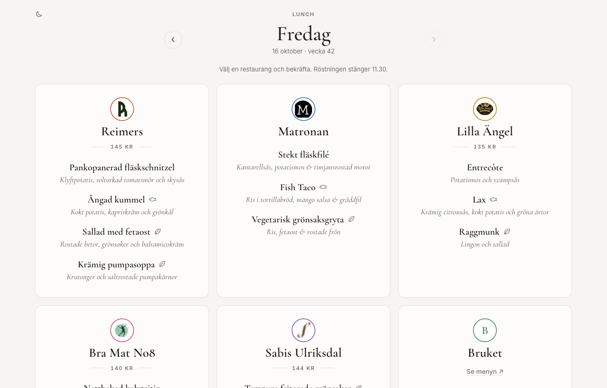
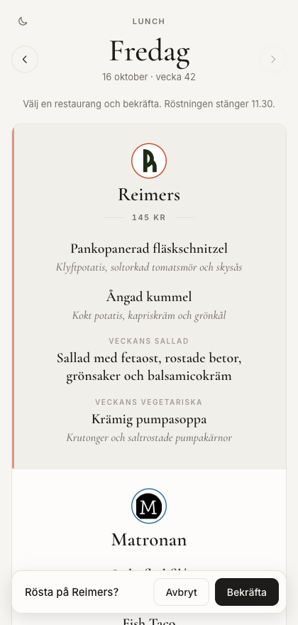
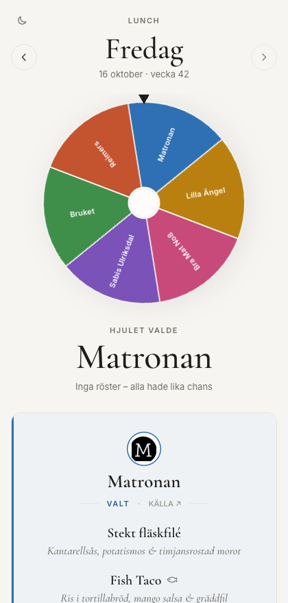
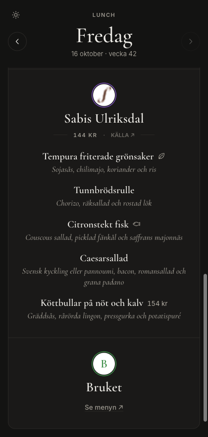
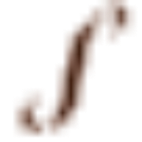
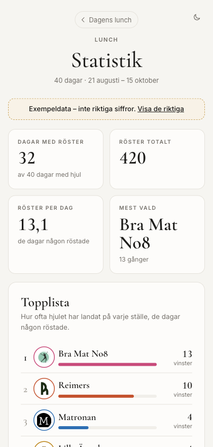
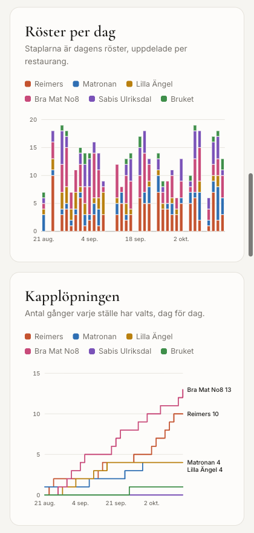

# Lunch

**Var ska vi äta idag?** 
Dagens menyer från restaurangerna runt kontoret, en omröstning på förmiddagen 
och ett lyckohjul som bestämmer klockan halv tolv.

### [→ Öppna lunchsidan](https://leonnorblad.github.io/lunchpicker/)

 

På datorn ligger menyerna sida vid sida

  

&nbsp;&nbsp;
&nbsp;&nbsp;

På mobilen: rösta · hjulet bestämmer · mörkt läge

 

## Så går en dag till

| När | Vad händer |
|---|---|
| **10.00** | Dagens menyer hämtas automatiskt från restaurangernas egna sidor: rätter, tillbehör och pris, ordagrant som de står där. |
| **Strax efter 10–11.30** | Rösta. Röstningen öppnar när menyerna är inlästa, och senast 10.30 (då med länkar till restaurangernas egna menyer om inläsningen inte blev av). Klicka på stället du vill äta på och bekräfta. Ändrar du dig går det att byta fram till 11.30. |
| **11.30** | Hjulet snurrar. Varje restaurang får en bit som är lika stor som dess andel av rösterna, så den populäraste har störst chans, men inget är avgjort i förväg. Alla ser samma hjul och samma vinnare. Har ingen röstat har alla lika stor chans. |
| **Efteråt** | Alla menyer finns kvar under hjulet, med den valda restaurangen först. |

Små ikoner efter rätterna visar vad som är fisk, fågel, vegetariskt eller veganskt. Bläddra mellan dagarna med pilarna,
och byt mellan ljust och mörkt läge med knappen uppe till vänster.

## Restaurangerna

| | Restaurang | Menyn kommer från |
|---|---|---|
|  | **Reimers** | [reimers.se](https://www.reimers.se/lunch/) |
|  | **Matronan** | [matronan.se](https://www.matronan.se/) |
|  | **Lilla Ängel** | [lillaangel.com](https://www.lillaangel.com/frosunda/lunch/) |
|  | **Bra Mat No8** | [bramat8.se](https://www.bramat8.se/lunch) |
|  | **Sabis Ulriksdal** | [sabis.se](https://www.sabis.se/restauranger-cafeer/vara-publika-restauranger/sabis-ulriksdal/) |
| | **Bruket** | [Compass Group](https://compass.mashie.matildaplatform.com/public/app/ncc+hk/b079ac04?country=se) |

Hittas ingen meny en dag står det så, med en länk till restaurangens sida. Inga rätter hittas på.

## Statistik (kommer snart)

Rösterna och hjulets val sparas varje dag, och när det har samlats lite mer kommer en statistiksida:
topplista, hjulets val dag för dag, röster över tid, vilka veckodagar som vinner och lunchpriserna.
Dagar då ingen röstade räknas inte, så statistiken visar vad vi faktiskt valde.

&nbsp;&nbsp;

Förhandsvisning med påhittad exempeldata

## Bra att veta

- Varje webbläsare har en röst per dag. Rösterna är anonyma.
- Menyerna hämtas av en [Claude Code-rutin](https://code.claude.com/docs/en/routines) som körs i molnet varje vardagsmorgon.
- Sidan är statisk och ligger på GitHub Pages. Ingen inloggning och inga kakor, bara det din webbläsare själv sparar
  (din röst och om du valt mörkt läge).

---

Ska du ändra något i koden? Börja med [`CLAUDE.md`](CLAUDE.md) och underhållsguiden i
[`.claude/skills/maintain-lunch/SKILL.md`](.claude/skills/maintain-lunch/SKILL.md).
